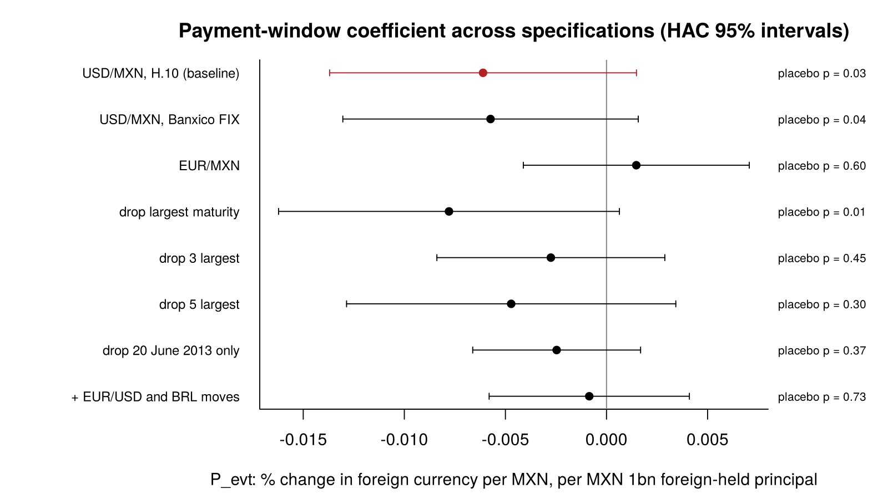

# Mexico Mbono repayments and the peso — update for Dori

5 November 2026

## Summary

The peso weakens in the fixing window when foreign-held Mbono principal is repaid: −0.006% per MXN 1bn (placebo p = 0.03), and the result holds on Banxico FIX (p = 0.04). It is not robust. It disappears in EUR/MXN, it is no longer distinguishable from chance once the 3 largest maturities are dropped, and dropping one day, 20 June 2013, removes about 60% of it. That day followed the June 2013 FOMC press conference: most of the "repayment effect" looks like a dollar-wide, emerging-market-wide move on repayment days.

## Model

The team's principal-only regression (`R/04_run_regressions.R`), unchanged, run by `R/06_robustness.R`:

- **Events:** 26 Mbono principal repayments, 2010–2025, sized by foreign-held principal from Banxico's weekly holdings (MXN 2.6–81.3bn).
- **Outcome:** r = 100 × Δlog(foreign currency per MXN) between consecutive fixings; positive = peso appreciation.
- **Regression:** r on principal settling 1–5 windows ahead (P_pre), in this window or the next (P_evt), and 2–5 windows back (P_post), with VIX, US 2-year yield and Brent controls. Newey-West standard errors, 10 lags.
- **Placebo:** the same 26 amounts placed on random non-event windows, 1,000 draws.

## Who holds Mexican debt

After the US, the largest holders are the Cayman Islands and Luxembourg, both mostly fund-registration hubs. Excluding hubs (and Ireland), the next investor countries are Japan and Germany.

| Holder country | End-2025 ($bn) | Note |
| --- | --- | --- |
| United States | 90.2 | |
| Cayman Islands | 28.3 | fund hub |
| Luxembourg | 24.6 | fund hub |
| Ireland | 15.0 | fund hub |
| Japan | 13.0 | |
| Germany | 12.5 | |

Source: IMF Portfolio Investment Positions by Counterpart Economy ([PIP](https://data.imf.org/en/datasets/IMF.STA:PIP)), all Mexican long-term debt securities (not only Mbonos). Full series: `output/imf_pip_mexico_lt_debt_by_holder.csv`.

## Results

| Test | P_evt | Placebo p |
| --- | --- | --- |
| USD/MXN, H.10 (baseline) | −0.0061 | 0.03 |
| USD/MXN, Banxico FIX | −0.0057 | 0.04 |
| EUR/MXN | +0.0015 | 0.60 |
| Drop largest maturity (Dec 2013) | −0.0078 | 0.01 |
| Drop 3 largest | −0.0028 | 0.45 |
| Drop 5 largest | −0.0047 | 0.30 |
| Drop 20 June 2013 only | −0.0025 | 0.37 |
| + same-window EUR/USD and BRL moves | −0.0009 | 0.73 |

For a typical repayment (MXN 20bn foreign-held) the baseline implies a 0.12% peso move, against a normal daily move of 0.74%.

## Caveats

- **Few events:** 26 repayments; the six largest all fall in 2013–2020.
- **Fed overlap:** Mbonos mature mid-June and mid-December. Confirmed for 20 June 2013 (the morning after the [FOMC press conference](https://www.federalreserve.gov/monetarypolicy/fomcpresconf20130619.htm)); other dates still to check.
- **Earlier "FIX" runs were H.10:** the FIX file was missing and the code fell back silently. It now warns.
- **Hedging unknown:** we measure foreign-held principal, not the unhedged part.
- **Early exit:** much foreign selling happens in the 15 months before maturity, outside the repayment window.

## Questions for Dori

1. Could Capstone share intraday USD/MXN (and EUR/MXN) around these 26 dates? It would separate the 09:00 Mexico City settlement from a 14:00 New York FOMC decision.
2. Which next path do you prefer: **cross-currency tests** (pairs weighted by holder country, FOMC-day controls) or **volatility and volume** around repayment and exit dates?
